# 🛡️ Awesome Row-Level Data Security 🔐

### Curated List of SaaS Products & Open-Source Projects for Fine-Grained Access Control (FGAC)

*Focused on Row Access Policies (RAP), Column-Level Security (CLS), Dynamic Data Masking, Attribute-Based Access Control (ABAC), and Multi-Tenant Isolation.*

**Last updated: November 2026**

---

## 📖 Introduction

This repository tracks notable **SaaS platforms** ☁️ and **open-source projects** 💻 for **Row-Level Data Security (RLS)** and **Fine-Grained Access Control (FGAC)**. These tools enable data platform teams, security architects, and backend engineers to control *which specific rows and records* a user or service account can query within a shared database or data warehouse—enforcing strict multi-tenant isolation, regional data residency compliance (GDPR, CCPA, HIPAA), and zero-trust data governance without copying datasets or maintaining sprawling client-side views.

---

## 📈 Sector Overview & Market Dynamics

The global **data access governance and fine-grained data security market** was valued at approximately **$2.14 billion in 2024** and is projected to expand to **$7.82 billion by 2032** 🚀, expanding rapidly alongside the broader enterprise data governance sector valued at over **$4.6 billion**. 

The sector is **moderately to highly fragmented** rather than winner-take-all: major hyperscalers and data platforms (Microsoft Purview, Snowflake, and Databricks) dominate native warehouse query runtimes, while specialized independent access governance engines (such as Immuta, Privacera, ALTR, and Protegrity) compete aggressively for cross-platform, multi-cloud enterprise enforcement, and a vibrant open-source ecosystem secures application-layer and proxy-level policy execution.

---

## 📑 Table of Contents

- [📖 Introduction](#-introduction)
- [📈 Sector Overview & Market Dynamics](#-sector-overview--market-dynamics)
- [☁️ SaaS/Hosted Platforms](#️-saashosted-platforms)
- [💻 Open-Source GitHub Projects](#-open-source-github-projects)
- [🤝 How to Contribute](#-how-to-contribute)
- [⭐ Star History](#-star-history)
- [💖 Support](#-support)
- [⚠️ Disclaimer](#️-disclaimer)

---

## ☁️ SaaS/Hosted Platforms

The table below lists leading SaaS and commercial hosted platforms providing row-level security, attribute-based access control (ABAC), and data access governance. Entries are sorted descending by company size (valuation / market capitalization / revenue).

| Platform / Vendor | Valuation / Revenue 🏢 | Pricing (Starting Tier) 💵 | Free Tier / Trial Limit 🎁 | Key Row-Level Security Capabilities 🔑 |
| :--- | :--- | :--- | :--- | :--- |
| **[Microsoft Purview](https://learn.microsoft.com/en-us/purview/purview)** | **~$3.1 Trillion** market cap (Microsoft) | **$0.24 per capacity unit / hour** (~$175/month baseline for Data Map governance) | **30-day free trial**; includes up to $200 Azure cloud credits for initial deployment and scanning | Enterprise governance and discovery layer. Purview integrates policy classification with platform-native RLS engines across Azure SQL, Synapse, and Power BI. |
| **[Snowflake (Row Access Policies)](https://docs.snowflake.com/en/user-guide/security-row-intro)** | **~$55 Billion** market cap | **$2.00 per credit** (Standard Edition) or **$3.00 per credit** (Enterprise Edition) | **30-day free trial** with **$400 in free usage credits**; full access to Enterprise features | Native SQL-based `ROW ACCESS POLICY` evaluating boolean expressions per session context (`CURRENT_ROLE()`, session attributes) directly in the compute engine. |
| **[Databricks (Unity Catalog)](https://docs.databricks.com/aws/en/data-governance/unity-catalog/filters-and-masks)** | **~$43 Billion** valuation | **$0.07 to $0.55 per DBU** (Standard to Enterprise compute runtime) | **14-day free trial** with full platform capabilities; excludes underlying cloud compute/VM charges | Built-in `ROW FILTER` and column masks on Unity Catalog tables. Supports centralized ABAC inheritance via catalog/schema tags. |
| **[Varonis (Cyral & Satori)](https://www.varonis.com/)** | **~$6 Billion** market cap | **$50.00 to $525.00 per protected database / month** (Cyral / Satori DAM baseline) | **30-day free trial** of full data security platform across multi-cloud environments | Query-time database access proxy with fine-grained row-filtering, tokenization, dynamic masking, and database activity monitoring. |
| **[Immuta](https://www.immuta.com/)** | **~$1.3 Billion** valuation | **$96,000.00 / year** (baseline 12-month package for 960 Immuta Units on AWS Marketplace) | **14-day free trial** for Immuta SaaS with guided sample data and warehouse connections | Universal cloud data access governance platform. Enforces attribute-based row filtering and masking across Databricks, Snowflake, Starburst, and BigQuery. |
| **[Privacera](https://privacera.com/)** | **~$350 Million** valuation | **$100,000.00 / year** (PrivaceraCloud Starter Pack 12-month commitment) | **30-day free trial** of PrivaceraCloud; covers connectors and discovery | Centralized data governance built on Apache Ranger APIs. Provides dynamic row-level security and column-level masking across 50+ data sources. |
| **[Protegrity](https://www.protegrity.com/)** | **~$150 Million** estimated valuation | **$225,000.00 / year** (Protegrity Enterprise Edition base entitlement on AWS Marketplace) | **30-day evaluation license** available upon enterprise request | High-performance enterprise data protection platform specializing in vaultless tokenization, format-preserving encryption, and dynamic row filtering. |
| **[ALTR](https://www.altra.io/)** | **~$70 Million** valuation | **$0.00 / month** (Free Community plan) or **$10.00 per data user / month** (Standard paid tier) | **Free forever plan** for up to 1 database connection and baseline consumption analytics | Cloud-native data access governance built around Snowflake Partner Connect; provides query-level row access control and vaultless tokenization. |
| **[SecuPi](https://www.secupi.com/)** | **~$60 Million** estimated valuation | **$50,000.00 / year** (baseline entry license for Policy Administration Server) | **30-day proof-of-concept (PoC) evaluation** license via cloud marketplace engagement | In-line proxy and agent-based policy enforcement delivering real-time ABAC row-level filtering, column masking, and user behavior analytics. |

---

## 💻 Open-Source GitHub Projects

Leading open-source projects for row-level security, policy-based access control, SQL query proxying, and relationship-based multi-tenancy. Sorted descending by GitHub star count.

| Project 📦 | GitHub Stars ⭐ | Description & Row-Level Security Capabilities 🛠️ |
| :--- | :--- | :--- |
| **[Apache Superset](https://github.com/apache/superset)** |  | Modern open-source enterprise business intelligence web application featuring built-in **Row Level Security (RLS)** filters applied automatically to virtual datasets based on user roles and attributes. |
| **[PostgREST](https://github.com/PostgREST/postgrest)** |  | Standalone web server that turns any PostgreSQL database directly into a RESTful API, relying completely on **PostgreSQL Row-Level Security (RLS)** and JWT claims to enforce multi-tenant isolation. |
| **[Casbin](https://github.com/casbin/casbin)** |  | Powerful, efficient open-source access control library supporting ACL, RBAC, ABAC, and multi-tenant domain models. Generates SQL filtering conditions to enforce row-level access in database queries. |
| **[Trino](https://github.com/trinodb/trino)** |  | Distributed SQL query engine for big data with native **Row Filtering and Column Masking** SPI, dynamically altering query execution plans to restrict visible rows per user identity. |
| **[Open Policy Agent (OPA)](https://github.com/open-policy-agent/opa)** |  | General-purpose policy engine with **Partial Evaluation**. Translates high-level Rego policies directly into SQL `WHERE` clauses for automated, performant row-level filtering in database adapters. |
| **[SpiceDB](https://github.com/authzed/spicedb)** |  | Open-source, Google Zanzibar-inspired database system for managing fine-grained permissions and relationship-based access control (ReBAC) for row-level entities and tenant hierarchies. |
| **[OpenFGA](https://github.com/openfga/openfga)** |  | CNCF relation-based fine-grained authorization engine designed for cloud-native scale, enabling flexible row-level resource access checks across microservices. |
| **[Permify](https://github.com/Permify/permify)** |  | Open-source authorization service based on Google Zanzibar with native support for ABAC attributes, multi-tenant isolation, and fine-grained row access control modeling. |
| **[Ory Keto](https://github.com/ory/keto)** |  | First open-source implementation of Google's Zanzibar paper written in Go; provides lightning-fast permission checks for individual record and row entitlements. |
| **[Cerbos](https://github.com/cerbos/cerbos)** |  | Decoupled policy decision point for context-aware access control. Features **Query Plan Generation** that converts authorization policies into database ASTs/SQL predicates for row-level security. |
| **[Helical Insight](https://github.com/helicalinsight/helicalinsight)** |  | Open-source enterprise BI framework with native multi-tenancy and declarative **Row-Level Security (RLS)** filtering data connections across tenant boundaries. |
| **[Apache Ranger](https://github.com/apache/ranger)** |  | Comprehensive security framework across Hadoop and big data ecosystems (Spark, Hive, Trino) providing centralized policy administration with dynamic **Row-Level Filtering** and **Column Masking**. |
| **[FastAPI-Permissions](https://github.com/holgi/fastapi-permissions)** |  | Row-level security and ACL permission system for the FastAPI framework, checking user access and scoping querysets per entity row. |
| **[SchemaGate](https://github.com/ashishsinha1602/schemagate)** |  | Text-to-SQL access control engine providing row-level-security-aware table pruning and query gating for LLM agents, LangChain, and MCP servers across Postgres, Oracle, and MySQL. |
| **[pg_rls](https://github.com/Dandush03/pg_rls)** |  | Ruby on Rails gem providing declarative PostgreSQL Row-Level Security for multi-tenant applications, eliminating manual tenant filter scoping in ActiveRecord. |
| **[AccessFlow](https://github.com/bablsoft/accessflow)** |  | Open-source database access proxy sitting between clients and heterogeneous databases (Postgres, MySQL, Oracle, MongoDB) to enforce pre-execution row security, masking, and audit logging. |

---

## 🤝 How to Contribute

Contributions are welcome! Please follow these guidelines:

1. 🍴 Fork this repository.
2. 📝 Add or update entries in `README.md` conforming to the tabular format with specific pricing, trials, star badges, and links.
3. 🔍 Keep descriptions factual, objective, and linked directly to official documentation or source code.
4. 🚀 Submit a Pull Request with a clear summary of your changes.

---

## ⭐ Star History

---

## 💖 Support

Thank you for exploring this curated guide to Row-Level Data Security! If you found this repository helpful, please consider:

- ⭐ **Starring** the repository on GitHub
- 🍴 **Forking** it to keep a copy or contribute improvements
- 📢 **Sharing** it with colleagues, platform engineers, and security teams
- ☕ **Buying a coffee / Sponsoring** the maintainer via the [GitHub Sponsor Dashboard](https://github.com/sponsors/ishandutta2007)

Your support keeps open-source research and community documentation thriving! ✨

---

## ⚠️ Disclaimer

- This is a community-curated list maintained for educational and architectural evaluation purposes.
- Row-level security implementations handling regulated personal data must adhere strictly to compliance frameworks (GDPR, CCPA, HIPAA, PCI DSS).
- Policy enforcement carries compute considerations: complex SQL predicates or subqueries in row access policies can introduce query planning overhead (often 10–30% on multi-million row tables unless partition/clustering keys align). Benchmark representative analytical workloads before rolling out enterprise-wide policies.
